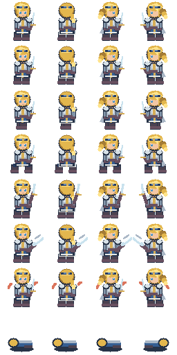

# 3.7.5 — Jeanne Art & Renderer Gate

## Statut et décision technique

**Prototype d'intégration livré, validation comparative encore ouverte.**

La branche a été réconciliée avec la campagne Acte I de la PR #62 : les 13 scènes,
les choix de recrutement, les missions de Vaucouleurs et les conséquences restent
présents. Les animations et le portrait Jeanne sont ajoutés au manifeste actuel,
sans retour à l'ancien prologue.
Le renderer de production reste **Tk Canvas** pour le vertical slice Jeanne :
c'est le seul backend déjà connecté à `BattleFrame`, au Studio et aux contrôles
de campagne, sans dépendance optionnelle. Le code tactique Python reste headless.

Ce choix est **provisoire** : ni pygame-ce ni PySide6 ne doit être déclaré
« plus rapide » sans les mesures reproductibles ci-dessous. Ne pas migrer le
Player avant validation graphique, clavier, DPI, packaging et autosave.

## Première héroïne jouable : Jeanne



- Direction artistique originale, sans reproduction d'une licence : cheveux
  **blonds**, yeux **bleus**, armure de campagne argentée, tunique bleu acier,
  détails or et lin. 2D pixel-art lisible dans une case tactique.
- Atlas PNG RGBA : **256 × 512**, frames **64 × 64** ;
  colonnes `south, north, east, west` ; lignes
  `idle_0, idle_1, move_0, move_1, attack_0, attack_1, hit_0, defeat_0`.
  Un portrait RGBA 64 × 64 est inclus.
- Identifiants stables `jeanne_<direction>_<action>_<frame>` et bindings
  `jeanne_<action>_<direction>` dans
  `sporebound/content/jeanne.game.json`. Portrait associé à l'intervenante
  de dialogue `Jeanne`. Pas de JSON manuel pour jouer la démo.
- Découpe des régions d'atlas en mémoire via `PhotoImage copy` ; la source
  est décodée **une fois** par renderer et les frames sont cachées.
  Les sprites et portraits classiques à fichier unique restent compatibles.
- Les animations sont cosmétiques : elles ne progressent pas le CT, les ticks,
  la RNG, les replays ou les sauvegardes.
- Les autres personnages restent en fallback vectoriel.

**Limite artistique :** ce premier pack 64 × 64 est une base cohérente et
jouable, pas une validation artistique définitive du character design. Les
décors, FX, expressions supplémentaires et les animations plus longues seront
itérés séparément. Les personnages ne doivent pas adopter les assets hérités
de Sporebound par défaut.

## Comparaison concrète, même workload

```sh
python -m unittest tests_standalone.test_jeanne_art_375 -v
python -m sporebound validate --content sporebound/content/jeanne.json --project sporebound/content/jeanne.game.json

# Dans une session graphique (X11/Wayland/Windows/macOS) :
python scripts/benchmark_renderers_375.py --backend tk --actors 80 --scale 1
python -m pip install pygame-ce PySide6  # uniquement dans un venv de test
python scripts/benchmark_renderers_375.py --backend pygame --actors 80 --scale 1
python scripts/benchmark_renderers_375.py --backend qt --actors 80 --scale 1
```

Pour automatiser la matrice complète et conserver les mesures par exécution,
lancer le collecteur (processus isolé par point de mesure) :

```sh
python scripts/collect_renderers_375.py --dry-run --output matrix.json
python scripts/collect_renderers_375.py \\
  --backends tk pygame qt --actors 20 80 200 --scales 1 2 \\
  --repeats 3 --frames 120 --output renderers-local.json

# CI Linux : smoke de performance réel sous Xvfb et artifact de preuves
xvfb-run -a python3 scripts/collect_renderers_375.py \\
  --backends tk --actors 20 80 --scales 1 2 \\
  --repeats 2 --frames 120 --output tk-evidence.json
```

Le rapport contient les 54 essais individuels attendus pour une matrice complète
(Tk/pygame-ce/PySide6 × 20/80/200 × 1x/2x × trois répétitions), le p50/p95 de
chaque essai, la médiane des p50/p95 et le p95 maximal par scénario.
Une bibliothèque optionnelle ou un display absent provoque un **échec explicite**,
jamais une mesure fictive ni un faux backend ignoré. Le critère p95 inférieur
à 33,3 ms est un indicateur non décisionnel du benchmark de blit :
il ne valide pas à lui seul les performances réelles du Player.

Chaque invocation doit utiliser un **processus indépendant**. Exécuter pour
`--actors 20, 80, 200`, `--scale 1, 2` sur Windows, Ubuntu et macOS, au
moins 120 frames et trois répétitions après warmup. Conserver les JSON obtenus
comme preuves de l'arbitrage. Les trois backends présentent la **même** région
de l'atlas RGBA, sur un viewport 800 × 600 avec les mêmes positions
déterministes et une image complète à chaque frame.

Le script mesure p50/p95 du temps mur du rendu + présentation UI, et un pic
**Python** via tracemalloc. Ce dernier n'inclut **pas** les allocations
natives Qt/SDL/Tk ou GPU : mesurer la mémoire résidente du processus avec un
outil OS dans le relevé final. La parité des outils GUI ne signifie pas
encore parité complète avec le Player (tuiles, overlays, sélection) : ce
prototype isole le coût du blit, avant un éventuel spike de Player alternatif.

### Gate à fermer avant choix final

| Critère | Cible | Situation |
| --- | --- | --- |
| 4 directions × 5 états + portrait | Runtime et validation sans lib externe | Implanté |
| Sécurité des régions d'atlas | Rejet des dimensions/coords invalides | Implanté |
| Gameplay et replay headless inchangés | Tests existants + nouveaux | Tests ajoutés |
| Comparaison Tk/pygame-ce/PySide6 | p50/p95 à 20/80/200 acteurs en 1x/2x | Harness livré ; mesures à exécuter |
| Performance Player réel | p95 < 33,3 ms à l'échelle cible, commandes fluides | Non encore mesurée |
| A11y, contrôle clavier, packaging sur 3 OS | Aucun recul fonctionnel | Non encore validé |

**Décision de repli :** conserver Tk tant que ces gates restent ouverts.
En cas de p95 trop élevé sur le Player réel, privilégier un spike
`pygame-ce` pour le combat, tout en gardant le Studio en Tk, et mesurer le
coût de deux runtimes. Considérer PySide6 si l'accessibilité et la gestion DPI
font gagner davantage que le coût de distribution Qt. Pas de réécriture du
moteur tactique, des formats d'assets ni des sauvegardes pour un renderer.

## Compatibilité de sauvegardes

L'ajout d'un registre non vide modifie le digest du projet Jeanne, comme prévu
par `docs/ASSET_PIPELINE.md`. Les checkpoints Jeanne antérieurs doivent donc
être **déclarés incompatibles**, sauf migration explicite après audit ; ne
jamais rejouer une sauvegarde sous un nouveau digest sans avertissement. Les
projets sans assets ne changent pas. Ce changement ne concerne ni les tables
tactiques ni les replays headless autonomes.
