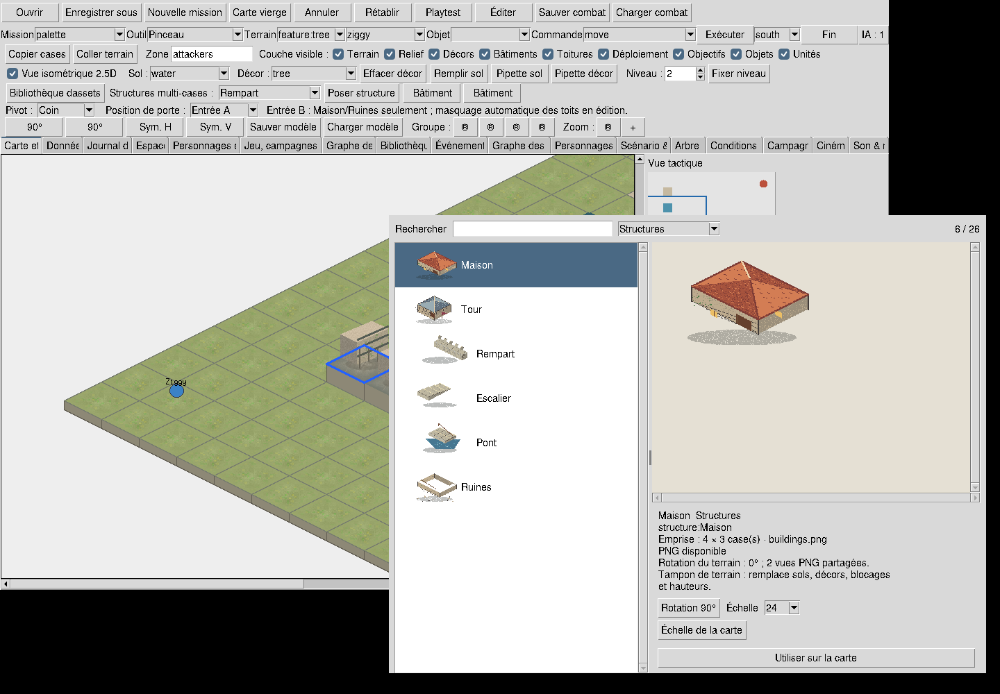

# 3.7.16A — Palette visuelle des assets de carte

## Parcours livré

Dans l'éditeur, ouvrir **Bibliothèque d’assets**. Chercher par nom français ou
identifiant (accents facultatifs), filtrer par catégorie, sélectionner une miniature,
puis **Utiliser sur la carte** et cliquer sur la carte. Le double-clic et Entrée
sur la liste activent également l'outil. La palette est non modale et réutilisée.

Les **26 entrées** correspondent exactement aux outils déjà disponibles : huit
sols, douze décors et six structures. L'aperçu accepte les échelles 24–96 et le
bouton **Échelle de la carte**. Les grandes images restent accessibles par les
barres de défilement. La rotation de structure modifie l'emprise et se transmet
au placement ; les deux vues PNG partagées sont annoncées, sans prétendre avoir
quatre illustrations différentes. Le pivot Coin/Centre/Porte reste celui de la
barre d'outils existante.

L'activation retourne à l'onglet Carte et à la vue isométrique, sans changer le
document. Le clic utilise les commandes habituelles : validation, protection des
unités/objets/objectifs et une transaction undo/redo. En Playtest, l'activation est
refusée avec un message demandant de revenir en Éditer. Aucune règle de déplacement,
combat, CT ou IA n'a été changée. Les effets existants eau/mur/blocage sont explicités.

Un PNG absent, invalide ou illisible par Tk est signalé dans la liste et l'inspecteur.
Le placement reste possible avec le rendu de secours existant. Le diagnostic reflète
les loaders de la session ; un fichier réparé après un échec demande de relancer
l'éditeur (les loaders existants mémorisent leurs échecs).

## Correction visuelle nécessaire

La capture initiale a révélé que les quatre loaders iso combinaient `-zoom` et
`-subsample` dans une seule copie Tk : arbres réduits à un carré, maison miniature
entièrement transparente. Ils utilisent maintenant `tk_images.crop_scaled` :
découpe de la frame, agrandissement puis réduction en étapes séparées. Le calcul
borné vient de la correction déjà utilisée par `CanvasRenderer._cell_photo` ; il
est partagé avec le Player, dont l'algorithme et le cache ne changent pas.

Les images intermédiaires sont bornées par les facteurs existants ; les caches
restent ceux des quatre loaders, partagés entre palette et carte. Aucun Pillow ni
autre dépendance n'est ajouté au runtime. Pillow sert uniquement à la capture
facultative de preuve dans le test graphique.



La capture vient du test de scène, après sauvegarde, réouverture et retour de
playtest. Elle prouve le catalogue et les miniatures ; elle ne constitue pas une
validation artistique d'un village final. Les rangées d'outils et onglets saturés
restent une dette UX identifiée dans l'audit.

## Architecture et vérification

- `asset_palette.py` adapte les constantes existantes : aucun nouveau registre de
  fichiers, format de carte ou contenu de mission.
- `studio_asset_palette.py` contient la fenêtre Tk ; `editor.py` branche sa sélection
  sur les variables/outils existants.
- `tk_images.py` partage le redimensionnement corrigé avec les loaders iso et le Player.
- `test_asset_palette_3716.py` : couverture exacte du catalogue, recherche, rotations,
  import sans Tk/Pillow.
- `test_asset_palette_gui.py` : vrais PNG et caches, absence/corruption, recherche vide,
  pixels en bas à droite de quatre atlas à cinq échelles ; création de scène via
  boutons/clics, pont tourné, undo/redo, sauvegarde, réouverture et blocage en playtest.
- Le test de minimap existant utilise désormais `winfo_pixels` : Tk peut renvoyer
  `10c` pour une largeur par défaut, ce qui n'est pas un entier en pixels.
- Workflow GUI Linux étendu avec le parcours palette. La matrice headless existante
  et le packaging multiplateforme restent actifs.

Commandes reproductibles :

```sh
python -m unittest discover -s tests_standalone -v
SPOREBOUND_GUI_SMOKE=1 xvfb-run -a python -m unittest discover -s tests_standalone -v
python -m build
python scripts/verify_distribution.py dist
```

## Limites et suite

Le lot A est un parcours utilisable, pas la fermeture de tout 3.7.16. Restent : assets
personnalisés du registre projet, animation/personnages, favoris, import guidé,
prévisualisation ancrée dans la scène et choix explicite des variantes. Les miroirs
et modèles terrain existent dans les outils historiques mais ne sont pas exposés
par cette fenêtre. La palette ne promet pas de convertir les PNG historiques en
objets jouables. Les règles des étages et les formats de sauvegarde restent inchangés.

Prochaine priorité : partager la présentation isométrique avec le Player et tester
l'occlusion, puis réaliser un village de référence avec une direction artistique
validée. Voir [audit et roadmap](EDITOR_ROADMAP_3716_3722.md).

## Résultats locaux — 12 octobre 2026

- Base master avant changement : 711 tests, OK, 62 tests graphiques ignorés.
- Version livrée, Linux / Python 3.12 / Tk avec Xvfb : **718 tests, OK,
  aucun ignoré**, 114,122 s. La suite inclut les régressions graphiques du Player.
- `python -m sporebound validate` : 4 missions, 21 compétences, 4 classes valides.
- Wheel et sdist construits ; `verify_distribution.py` réussit hors du checkout,
  simulation puis replay avec hash identique.
- Capture inspectée : les six structures apparaissent entièrement dans les miniatures.
- Windows/macOS et Python 3.10/3.14 : vérification confiée à la CI de la PR ;
  ces résultats locaux ne les remplacent pas. GUI native Windows/macOS non validée ici.
